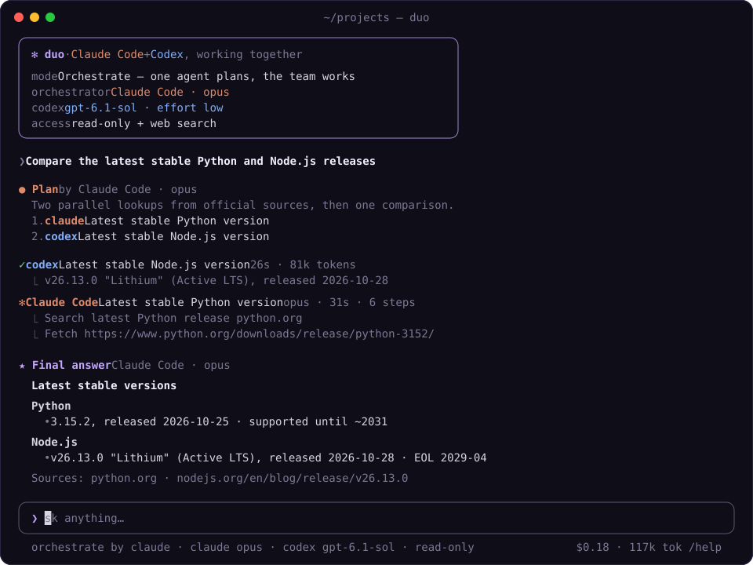

<div align="center">


# duo

### Claude Code and Codex, one prompt.

**Ask once and both agents answer in parallel, merged into one reply.**<br>
Or let one of them plan the work and hand tasks to the other.

[](LICENSE) [](https://nodejs.org) [](https://github.com/RalphKGM/duo/stargazers)

**[Install](#quick-start)** &nbsp;·&nbsp; **[Modes](#modes)** &nbsp;·&nbsp; **[Commands](#commands)** &nbsp;·&nbsp; **[Settings](#settings)** &nbsp;·&nbsp; **[Limits](#limits)**

<br>



</div>

<br>

## Is duo for you?

Claude Code and Codex are good at different things, and they're wrong about different things. Asking both usually means two terminals, the same prompt pasted twice, and reading two answers side by side. duo does that for you:

- **Parallel.** Both agents get the prompt at the same time. When they finish, one merged answer comes back, with a short note on anything they disagree about.
- **Orchestrate.** One agent (you pick which, and on what model) splits the request into tasks, assigns each to an agent, runs them in parallel and writes the final answer. You approve the plan before anything runs.
- **Single.** Talk to one agent, or prefix a prompt with `@claude` or `@codex`.

It's for you if you already have both CLIs installed and logged in. If you only use one agent, you don't need it.

duo drives the official `claude` and `codex` CLIs in headless mode. Your existing logins, plans and config are used as they are. It makes no API calls of its own.

## Quick start

**1 · Install the agents.** [Claude Code](https://docs.anthropic.com/en/docs/claude-code) and [Codex CLI](https://github.com/openai/codex), both logged in. Node 18 or newer.

**2 · Install duo.**

```sh
npm install -g github:RalphKGM/duo
```

**3 · Run it.**

```sh
duo                                   # open duo
duo "best self-hosted photo backup?"  # open and ask right away
duo -d ~/code/my-app                  # work in another folder
```

Inside duo:

```text
❯ which postgres backup tool should I use for a 200 GB database?
❯ @codex explain src/server.ts
❯ /mode orchestrate
❯ /write
```

## Modes

```text
 parallel                 orchestrate                         single

   prompt                    prompt                            prompt
   ┌──┴──┐                     │                                 │
claude  codex          orchestrator plans                 claude or codex
   └──┬──┘              ┌──────┼──────┐
   merged            task 1  task 2  task 3    run in parallel,
   answer               └──────┼──────┘        depends_on respected
                       orchestrator writes
                         the final answer
```

Switch with `/mode`. Choose the orchestrator, its model and its effort with `/orchestrator`.

Follow-up prompts continue each agent's session, so "now compare it with X" works. `/new` starts over.

## Editing code

duo is read-only by default: agents can read files and search the web, nothing else. `/write` lets them edit files and run commands.

In parallel mode inside a git repo, each agent gets its own worktree and branch, so the two never edit the same checkout:

```text
⎿ Claude Code's changes are on branch duo/2026-11-08-03-25-41/claude
  calc.py | 2 +-
⎿ Codex's changes are on branch duo/2026-11-08-03-25-41/codex
  calc.py | 2 +-
```

`/keep` merges the version you pick into your branch and removes the other one. Cancelling a run removes both.

## Commands

| Command | |
|---|---|
| `/mode` | parallel, orchestrate or single |
| `/orchestrator` | which agent plans, plus its model and effort |
| `/model` | default model per agent |
| `/effort` | reasoning effort per agent |
| `/agents` | turn an agent on or off |
| `/write` | toggle read-only and write |
| `/keep` | merge one agent's branch after a write run |
| `/new` | forget the conversation |
| `/cwd` | change the working folder |
| `/copy` | copy the last answer |
| `/runs` | open saved runs |
| `/settings` | everything above, plus the options below |

`esc` cancels a run. `↑` `↓` go through history. `tab` completes a command. `ctrl+c` twice quits.

## Settings

Saved to `~/.duo/config.json`. `"default"` means whatever that CLI is already set to.

```jsonc
{
  "mode": "parallel",
  "models": { "claude": "default", "codex": "default" },
  "effort": { "claude": "default", "codex": "default" },
  "orchestrator": { "agent": "claude", "model": "opus", "effort": "default" },
  "merge": { "enabled": true, "agent": "claude", "model": "sonnet" },
  "access": "research",        // or "write"
  "isolation": "worktree",     // or "shared"
  "planApproval": "ask",       // or "auto"
  "maxTasks": 6,
  "maxParallel": 4,
  "lean": true
}
```

**`lean`** starts duo's Claude calls without your MCP servers and skills. On a setup with a few large MCP servers, a one-line question went from about 520k tokens of context to about 5k. Turn it off if you want the agents to use your MCP tools.

Every run is saved to `~/.duo/runs/<timestamp>/`: the prompt, each agent's answer, the plan and the final answer.

## Cost

duo is free. Each prompt uses your Claude and OpenAI plans the same way running the CLIs yourself would. Parallel mode runs both agents, so expect about twice the usage, plus a small merge step on Sonnet.

For reference, the orchestrate run in the screenshot (plan on Opus, two research tasks, final answer) cost $0.18 on the Claude side.

## Limits

- Two agents for now: Claude Code and Codex. Each agent is one small adapter in [`lib/agents.js`](lib/agents.js), and Gemini CLI and opencode are next.
- You can't type the next prompt while agents are working.
- Worktree isolation needs a git repo with at least one commit. Outside one, write mode uses the shared folder and says so.
- Tested on macOS. `/copy` uses `pbcopy`.

## Development

```sh
git clone https://github.com/RalphKGM/duo.git
cd duo && npm install
node cli.js
```

See [CONTRIBUTING.md](CONTRIBUTING.md) for how the code is laid out.

## License

[MIT](LICENSE)

<sub>Not affiliated with Anthropic or OpenAI.</sub>
